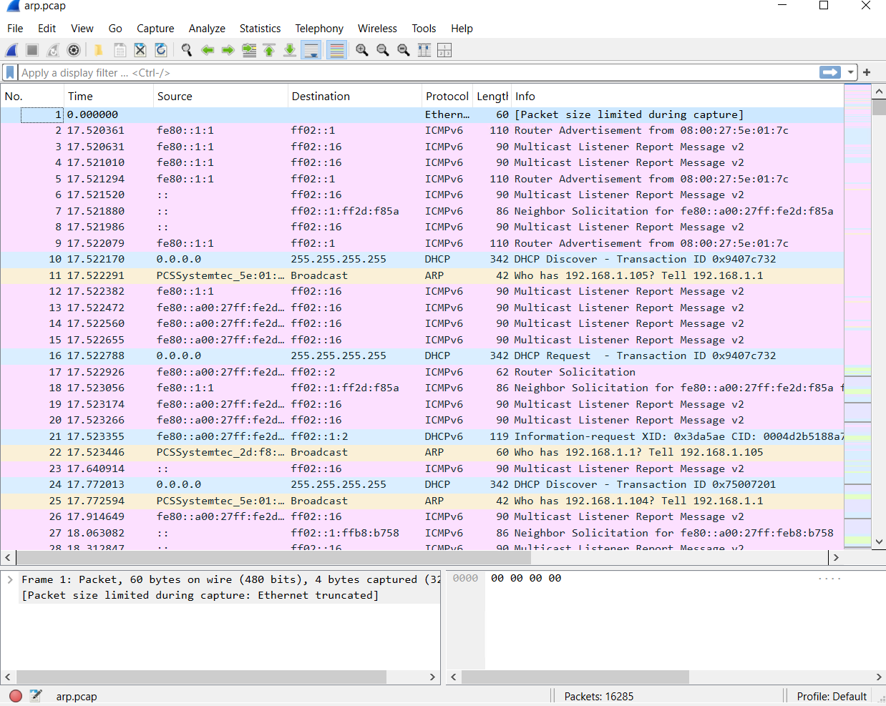
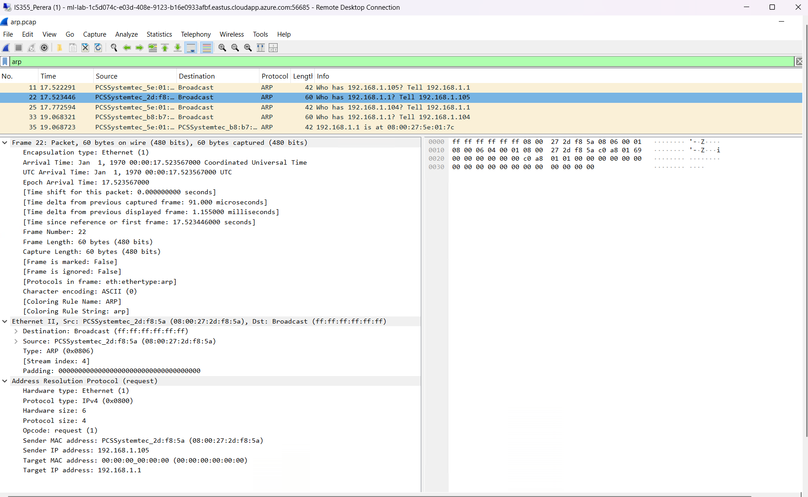
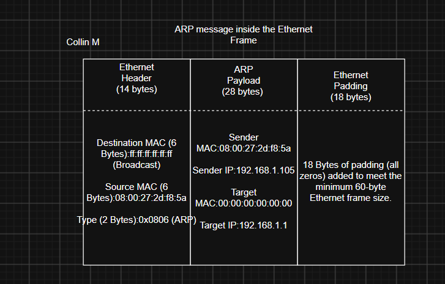
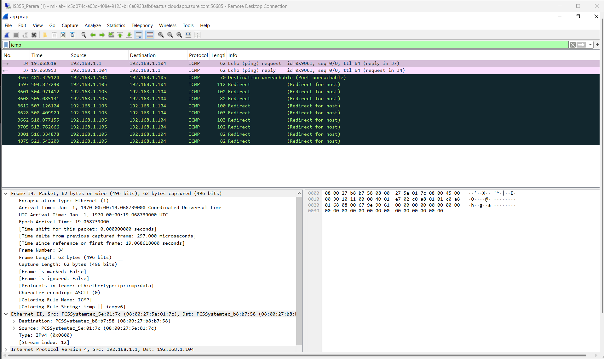
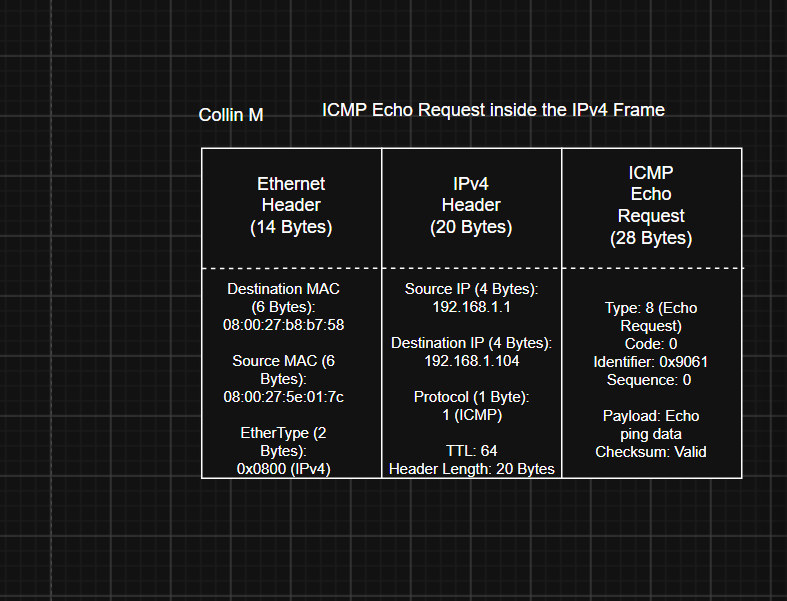
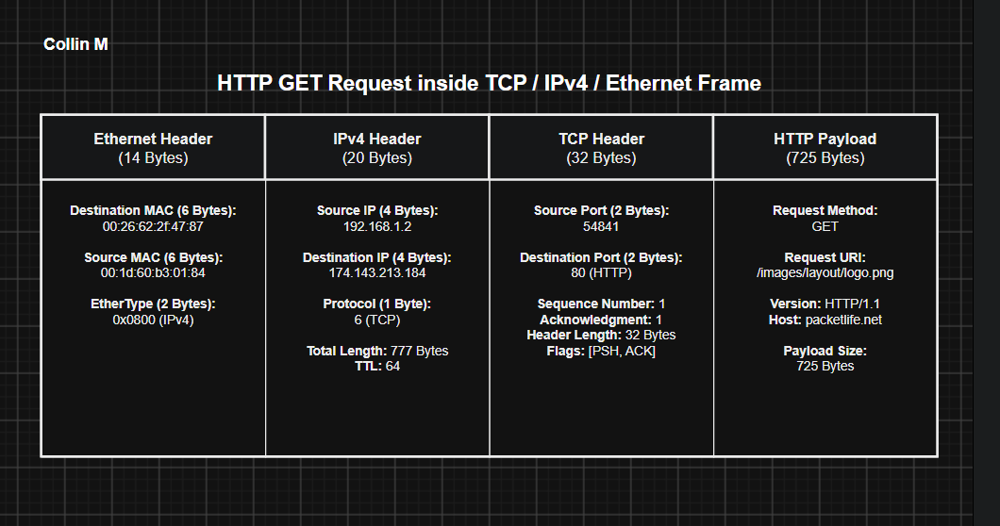

### Wireshark ARP Capture Overview

#### Packet Analysis:
* **Captured Traffic:** The capture shows background IPv6 ICMPv6 messages, DHCP configuration handshakes, and periodic ARP broadcast requests across the local subnet.
* **Key Observations:**
  * **Packet 11:** Broadcast ARP query from `PCSSystemtec_5e:01:7c` (`192.168.1.1`) inquiring *"Who has 192.168.1.105? Tell 192.168.1.1"*.
  * **Packet 22:** Broadcast ARP query from `PCSSystemtec_2d:f8:5a` (`192.168.1.105`) inquiring *"Who has 192.168.1.1? Tell 192.168.1.105"*.
  * **Packet 35:** Unicast ARP reply from `08:00:27:5e:01:7c` confirming that `192.168.1.1` is located at hardware MAC address `08:00:27:5e:01:7c`.

### Packet 22: ARP Request Deep Dive & Encapsulation

#### Addressing & Protocol Breakdown:
* **Frame Layer (Physical/Data Link):**
  * **Frame Length:** 60 bytes on wire (480 bits)
  * **Capture Length:** 60 bytes
  * **Encapsulation Type:** Ethernet (1)
* **Ethernet II Layer:**
  * **Destination MAC:** `ff:ff:ff:ff:ff:ff` (Broadcast)
  * **Source MAC:** `08:00:27:2d:f8:5a` (`PCSSystemtec_2d:f8:5a`)
  * **EtherType:** `0x0806` (Address Resolution Protocol)
  * **Ethernet Padding:** 18 bytes of null padding added to meet the minimum Ethernet frame specification (60 bytes excluding 4-byte FCS).
* **Address Resolution Protocol (ARP) Request Layer:**
  * **Hardware Type:** Ethernet (`1`)
  * **Protocol Type:** IPv4 (`0x0800`)
  * **Hardware Size:** 6 bytes
  * **Protocol Size:** 4 bytes
  * **Opcode:** Request (`1`)
  * **Sender MAC Address:** `08:00:27:2d:f8:5a`
  * **Sender IP Address:** `192.168.1.105`
  * **Target MAC Address:** `00:00:00:00:00:00` (All zeros, as it is unknown and being requested)
  * **Target IP Address:** `192.168.1.1`

#### Explanation:
Before the host `192.168.1.105` can transmit an IP packet to the gateway `192.168.1.1`, it must determine the gateway's Layer 2 MAC address. Since it is not currently stored in its local ARP table, the host sends this Layer 2 broadcast query. All machines receive the frame, but only the host assigned `192.168.1.1` processes and responds to it.

### d) Packet Encapsulation Diagram for 1st ARP Packet

* **Source File:** `arp-diagram.drawio`

| Layer | Component | Size | Key Values / Addresses |
| :--- | :--- | :--- | :--- |
| **Data Link (Header)** | Ethernet II Header | 14 Bytes | Src MAC: `08:00:27:2d:f8:5a` Dst MAC: `ff:ff:ff:ff:ff:ff` Type: `0x0806` (ARP) |
| **Network (Payload)** | ARP Request | 28 Bytes | Opcode: `1 (Request)` Sender MAC: `08:00:27:2d:f8:5a` Sender IP: `192.168.1.105` Target MAC: `00:00:00:00:00:00` Target IP: `192.168.1.1` |
| **Data Link (Padding)** | Ethernet Padding | 18 Bytes | 18 bytes null padding (0x00) to meet 60-byte frame requirement |
| **Total** | **Entire Frame** | **60 Bytes** | *(480 bits on wire)* |

### e) Explanation of the First Two ICMP Packets

#### 1. Packet 34 — ICMP Echo (ping) Request
* **Source IP:** `192.168.1.1`
* **Destination IP:** `192.168.1.104`
* **Timestamp:** `19.068618` seconds
* **Details:** `Type 8 (Echo request)`, `id=0x9061`, `seq=0/0`, `ttl=64`
* **Purpose:** Sent by the host at `192.168.1.1` to verify whether `192.168.1.104` is active and reachable over the network. It encapsulates a timestamp identifier and requests a reply.

#### 2. Packet 37 — ICMP Echo (ping) Reply
* **Source IP:** `192.168.1.104`
* **Destination IP:** `192.168.1.1`
* **Timestamp:** `19.068953` seconds
* **Details:** `Type 0 (Echo reply)`, matching `id=0x9061` and `seq=0/0`
* **Purpose:** Transmitted back by `192.168.1.104` immediately upon receiving Packet 34, returning the identifier and sequence number to confirm two-way communication.
* **Round-Trip Delay:**
  19.068953 s - 19.068618 s = 0.000335 s (0.335 ms)

  ### f) Packet Diagram for the First ICMP Packet (Packet 34)

* **Source File:** `icmp-diagram.drawio`
* **Total Frame Length:** 62 Bytes (496 bits on wire)

---

## Task 2: Analyze HTTP Packet Capture

### a) & b) Wireshark HTTP Overview

#### 1. Frame 4 — HTTP GET Request
* **Client IP & Ephemeral Port:** `192.168.1.2 : 54841`
* **Destination Web Server IP & Port:** `174.143.213.184 : 80` (HTTP)
* **Client MAC Address:** `00:1d:60:b3:01:84`
* **Gateway/Router MAC Address:** `00:26:62:2f:47:87`
* **Timestamp:** `0.046841` seconds
* **Request Line:** `GET /images/layout/logo.png HTTP/1.1`
* **Host Header:** `packetlife.net`
* **Total Frame Length:** 791 bytes (Ethernet: 14B, IP: 20B, TCP: 32B, HTTP Payload: 725B)
* **Purpose:** The client initiates an HTTP GET request to download an image asset (`logo.png`) hosted on `packetlife.net`.

#### 2. Frame 36 — HTTP Response
* **Server IP & Port:** `174.143.213.184 : 80`
* **Client IP & Port:** `192.168.1.2 : 54841`
* **Timestamp:** `0.205044` seconds
* **Status Code:** `HTTP/1.1 200 OK`
* **Content-Type:** `image/png`
* **Purpose:** The remote web server fulfills the client's request and returns the requested PNG image file.
* **Server Response Time (RTT):**
  0.205044 s - 0.046841 s = 0.158203 s (158.2 ms)

---

### c) & d) HTTP Packet Encapsulation Diagram

* **Source File:** `http-packet.drawio`
* **Total Frame Length:** 791 Bytes (6328 bits on wire)

| Layer | Component | Size | Key Values / Addresses |
| :--- | :--- | :--- | :--- |
| **Data Link** | Ethernet II Header | 14 Bytes | Src: `00:1d:60:b3:01:84` Dst: `00:26:62:2f:47:87` Type: `0x0800` (IPv4) |
| **Network** | IPv4 Header | 20 Bytes | Src: `192.168.1.2` Dst: `174.143.213.184` Protocol: `6 (TCP)` Total Length: 777 B |
| **Transport** | TCP Header | 32 Bytes | Src Port: `54841` Dst Port: `80` Seq: 1, Ack: 1 Flags: `[PSH, ACK]` |
| **Application** | HTTP Payload | 725 Bytes | `GET /images/layout/logo.png HTTP/1.1` Host: `packetlife.net` |
| **Total** | **Full Frame** | **791 Bytes** | *(6328 bits on wire)* |

---

## Task 3: Explore Other Resources and Interesting Points (E-Journal)

**Resource:** [Explore Azure SQL Database](https://learn.microsoft.com/en-us/training/modules/explore-relational-data-offerings/)

### Key Takeaways:
* **Firewall Security:** Azure SQL blocks all public internet traffic by default. Access requires setting explicit firewall IP rules or Virtual Network (VNet) endpoints.
* **Network Isolation:** In production, backend SQL databases should restrict inbound port access (1433) strictly to the web server's subnet instead of exposing it publicly.
* **Automatic Scaling:** Compute and storage can be scaled up or down on demand without downtime or manual failover setup.
